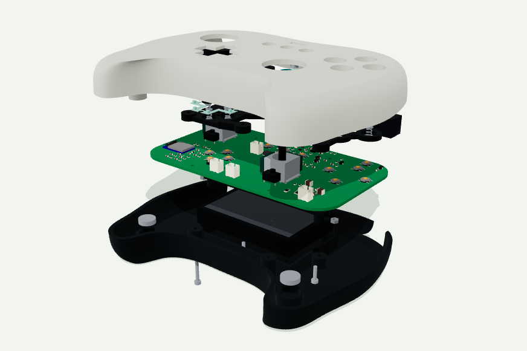
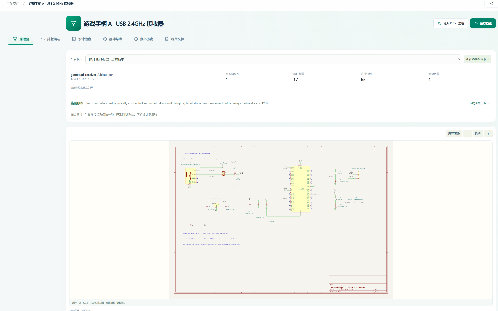
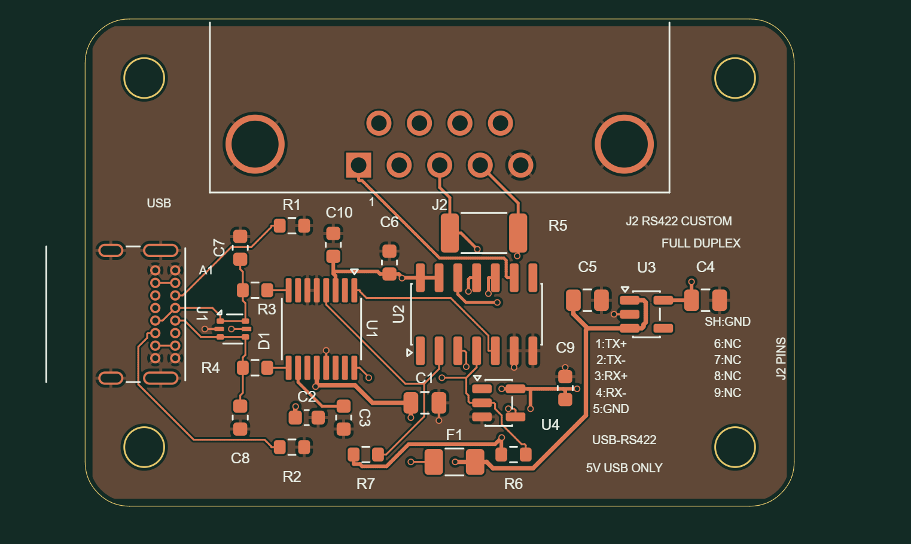
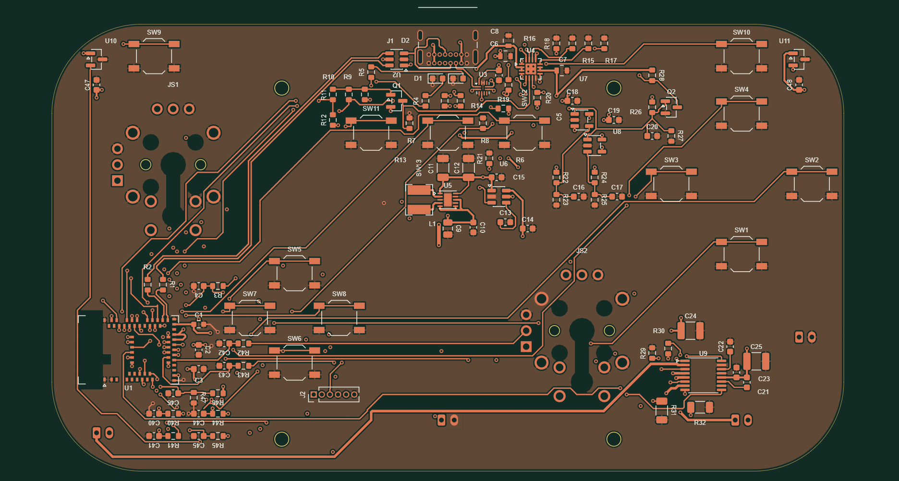
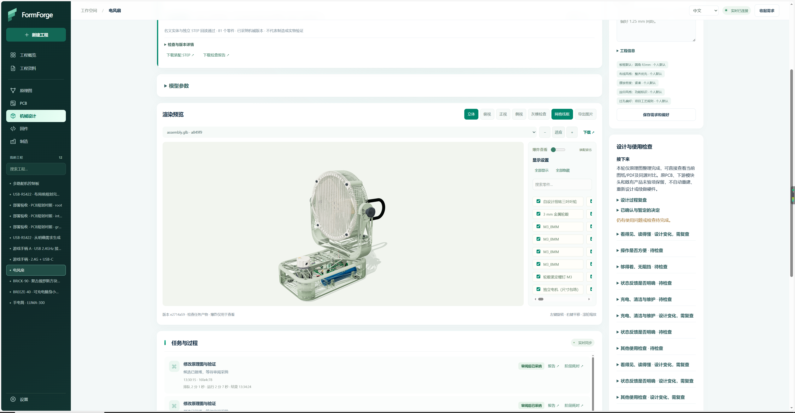
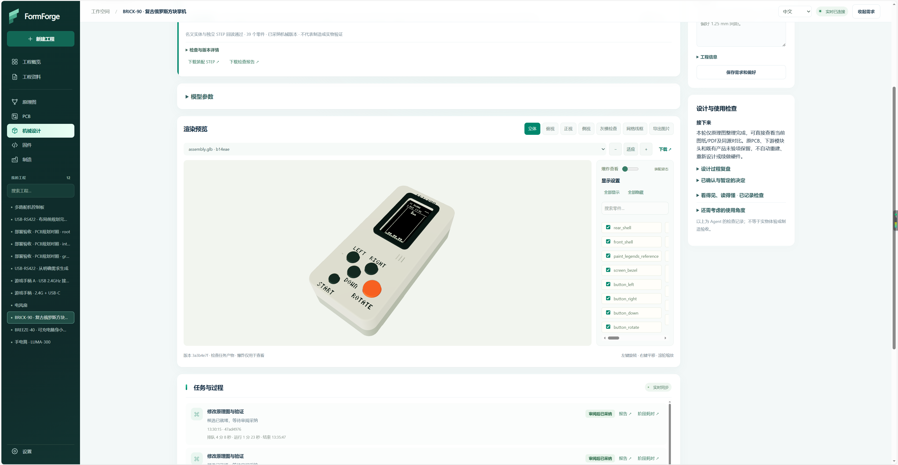
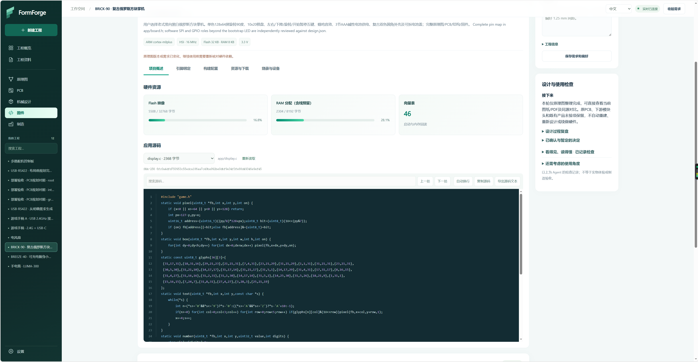

# FormForge

**A local engineering workbench where people and AI agents turn electronics ideas into editable, inspectable projects.**

[中文](README.md) · English

FormForge brings **requirements, schematics, PCB design, mechanical assemblies, firmware, and manufacturing files** into one project workflow. Use the web interface to inspect designs, adjust supported parameters, and review versions and results. An external AI agent connects through MCP to carry out explicit engineering tasks.

A game controller, for example, needs more than a circuit: button positions, PCB geometry, enclosure fit, firmware pin assignments, and manufacturing files must agree. FormForge links these activities and preserves the engineering files, input versions, and reports behind each result.

| Game controller assembly | Exploded assembly |
| --- | --- |
|  |  |

*The gallery shows CAD models and application screens from design work. The example project files are not bundled with this source repository. Images do not establish physical performance or approval for manufacturing.*

## What you can do

| Work | Available capabilities |
| --- | --- |
| Define requirements | Keep product requirements, preferences, confirmed decisions, open issues, and checks of how a product will be used |
| Design circuits | Create or import KiCad schematics, edit components and connections, and read native electrical checks and connectivity |
| Design PCBs | Plan placement, edit components and copper, use FormForge's own routing and local optimization tools, and review outlines, interface legends, and rules |
| Design mechanical parts | Build parametric geometry, work with complete PCBAs, inspect parts and exploded views, and export STEP / GLB / STL |
| Develop firmware | Bind firmware to hardware revisions and pins, generate supported STM32 templates, and build and inspect ELF / HEX / BIN files |
| Prepare manufacturing files | Organize Gerber, BOM, placement, and mechanical files; parse external manufacturing inputs; use supported supplier workflows |
| Manage projects | Preserve revisions, candidates, tasks, failures, reports, and source provenance; import and export project packages |

The first EDA backend is **KiCad 10**. PCB placement and routing retain FormForge's own implementation. Mechanical modeling uses CadQuery / OpenCascade, and firmware builds use the ARM GNU Toolchain.

## From circuits to assemblies and firmware

### Schematics

The schematic workspace brings drawings, revisions, components, connectivity groups, and check results together. Agents can make changes through the tools, then check them against native ERC and declared connectivity targets. The web interface displays the same revision for review.

### PCBs

The examples range from a USB-RS422 interface board with explicit pin legends to a game controller PCB with sticks, buttons, and control circuitry. Inspect copper layers and components, then use the tools for placement, routing, and checks. Connector access, mounting, power delivery, and return paths still require review for each design.

| USB-RS422 interface board | Game controller PCB |
| --- | --- |
|  |  |

### Mechanical design and assembly

Treat the board and its components as a complete PCBA alongside the enclosure, battery, controls, and fasteners. Use parameters, part visibility, multiple views, and exploded assemblies to inspect the internal arrangement. Export engineering geometry for further editing and review.

| Fan assembly and internal layout | Retro handheld enclosure |
| --- | --- |
|  |  |

### Firmware

Firmware is linked to hardware evidence and pin assignments. The workspace shows application source, Flash and RAM use, vector tables, and build artifacts. Eight STM32 targets currently support blink and UART echo templates; consult the capability interface for other template support. External firmware can also go through import, format validation, and offline flashing-plan preparation.

## Working with an agent

**Requirements and use cases → circuits → PCB → mechanical assembly → firmware → manufacturing files and review**

1. Create a project in the web interface and describe its purpose, interfaces, dimensions, and constraints.
2. Connect an external agent that can access the local MCP service.
3. Let the agent analyze requirements, propose choices, and call tools. Engineering engines produce or inspect actual project files.
4. Review candidates, drawings, models, and reports in the web interface, then continue iterating.
5. Adopt results when the required checks pass and the input version still matches. Reassess affected downstream work when an upstream design changes.

**The agent handles reasoning and decisions; FormForge executes explicit tasks and keeps the engineering evidence.** The service is not tied to a particular model and does not independently invoke paid models. Users remain involved in product tradeoffs, design review, and necessary physical testing.

The web interface, HTTP API, and MCP tools share the same business operations and project state.

## Local installation

**Windows x64** is the main validated platform. Install Python 3.12 and Node.js first; EDA functions also require KiCad 10. The installation check used Python 3.12.14, Node.js 24.14, and KiCad 10.0.6.

Run PowerShell from the repository root:

~~~powershell
powershell -NoProfile -ExecutionPolicy Bypass -File scripts/Setup.ps1
powershell -NoProfile -ExecutionPolicy Bypass -File scripts/Start.ps1
~~~

Open the [local workbench](http://127.0.0.1:17840), or double-click “启动FormForge.cmd”. The first run creates empty project storage and a new local API token.

Install optional modules as needed:

~~~powershell
# Mechanical modeling
powershell -NoProfile -ExecutionPolicy Bypass -File scripts/Setup-Mechanical.ps1

# External manufacturing-file parsing
powershell -NoProfile -ExecutionPolicy Bypass -File scripts/Setup-Cam.ps1 -PythonExe .venv\Scripts\python.exe

# Offline flashing tools and device packs
powershell -NoProfile -ExecutionPolicy Bypass -File scripts/Setup-Flash.ps1

# Procurement browser and desktop interface
powershell -NoProfile -ExecutionPolicy Bypass -File scripts/Setup-ProcurementBrowser.ps1
powershell -NoProfile -ExecutionPolicy Bypass -File scripts/Setup-Desktop.ps1
~~~

Firmware compilation also requires the ARM GNU Toolchain. Select it in settings or set FORMFORGE_ARM_GCC. For a non-default KiCad installation, set FORMFORGE_KICAD_CLI and FORMFORGE_KICAD_PYTHON. The desktop interface downloads an Electron runtime; the setup script provides a DownloadProxy option for restricted networks.

MCP uses the service's /mcp endpoint with Bearer authentication. The local token is stored in .local/api-token.txt. A stdio bridge is available at scripts/stdio-proxy.py. Use the token only in local client configuration; never commit it.

## Validation status

On November 4, 2026, the source was checked out again from this private repository and installed into four fresh Python environments on the same Windows host:

- **62 Python and 41 Node targeted checks passed**, covering selected project, native-tool, mechanical, manufacturing-file, offline-flashing, and browser-policy flows.
- **Eight STM32 targets × two templates: 16 real builds passed**, with ELF / HEX / BIN and vector-table checks.
- Real web UI checks covered project creation and renaming, eight module pages, and narrow-screen settings. MCP native tasks and HTTP / web reads referred to the same revision.
- Native Electron startup and workbench loading passed. Supplier screenshot operations in a hidden window were not counted as passing.

These results use configured local tools and test fixtures. Draft PCB routing checks do not establish acceptance of a complete physical board. CAD and build checks do not establish physical performance or manufacturing approval. A clean Windows / VM installation, real supplier login and live transactions, device flashing, and physical behavior require separate validation.

Reproduce the basic checks included in this repository:

~~~powershell
npm ci --no-audit --no-fund
npm run check
npm run build
.venv\Scripts\python.exe -m pytest tests/test_source_smoke.py
npm --prefix procurement-browser ci --ignore-scripts --no-audit --no-fund
node --test desktop/tests/*.test.cjs procurement-browser/tests/*.test.cjs
~~~

The bundled basic checks cover a subset of the full local acceptance work; the repository does not include all 103 external acceptance cases.

## Data and release status

Application projects and runtime data are stored locally by default. This repository contains source, dependency declarations, required runtime resources, third-party notices, and selected introduction images. It does not bundle daily project packages, orders, JLC account credentials, browser login state, or caches. Users configure supplier access and sign in locally. Quotation, submission, payment, and production release are separate operations; payment and production release are not automatic.

Keep generated data/, .local/, .cache/, and browser-profile directories private. Do not force-add them to Git.

**This repository remains private. Do not make it public, publish a public release, or create a public mirror without fresh explicit authorization from the owner.**

An open-source license has not yet been selected for the project's own code. Third-party code, fonts, and resources retain their respective licenses. Code ownership and third-party redistribution rights still need review before a public release.
