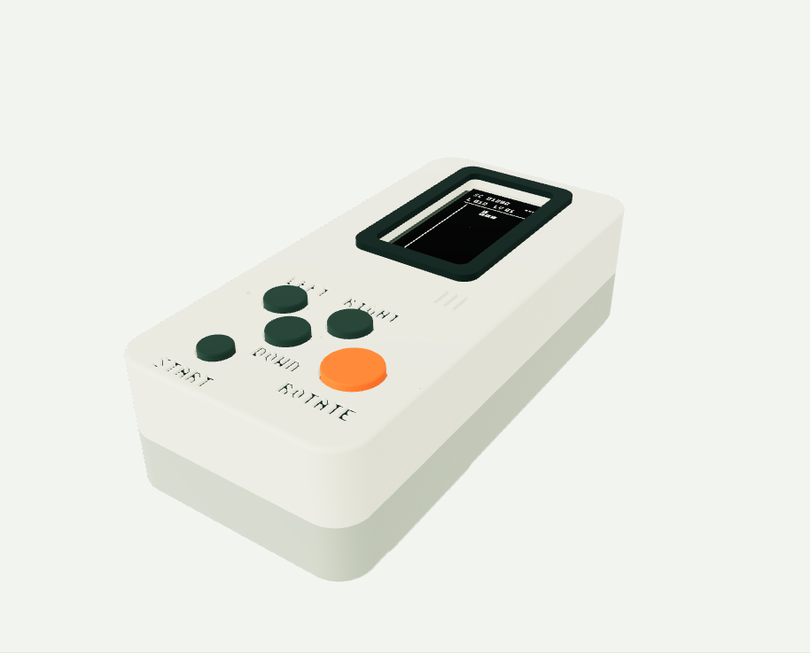
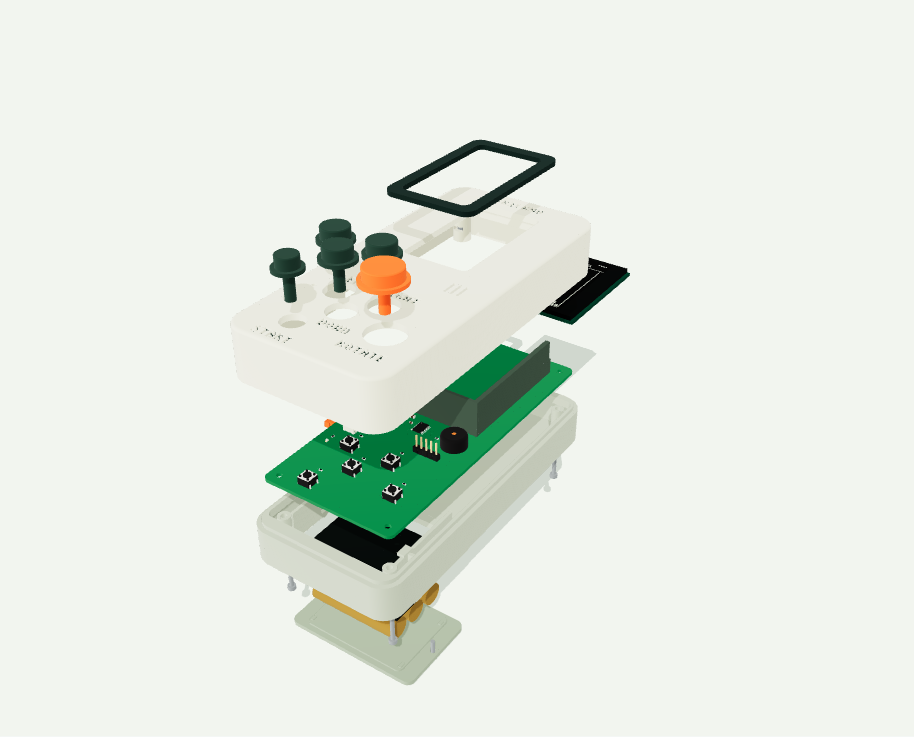
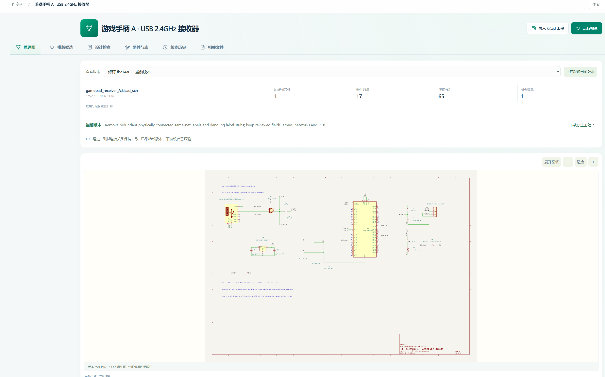
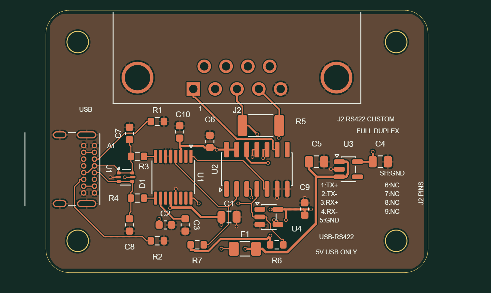
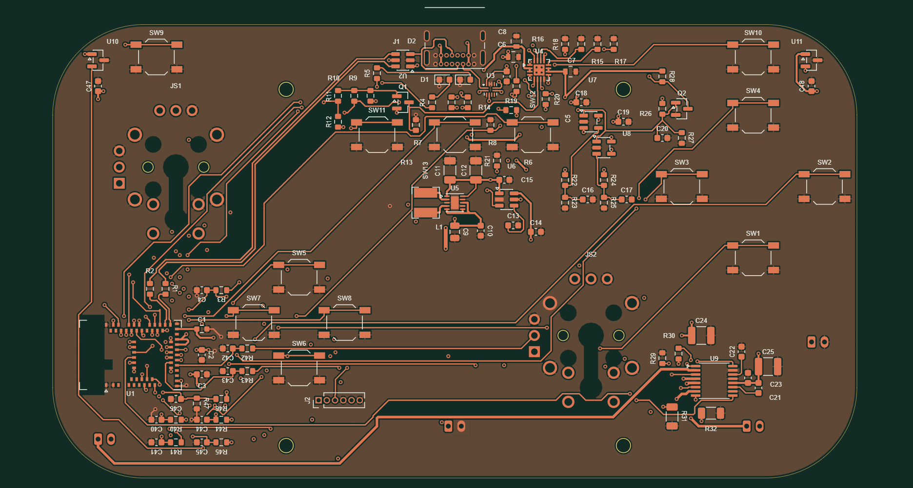
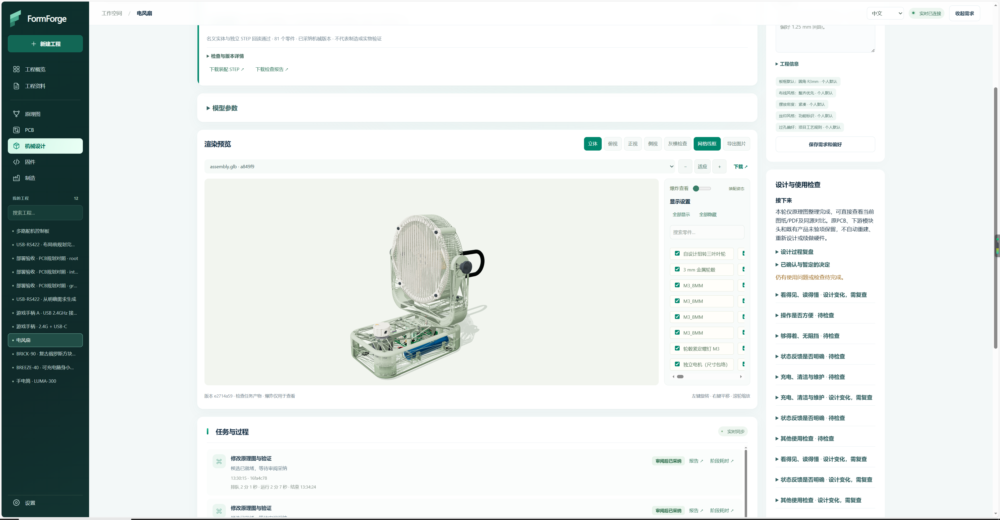
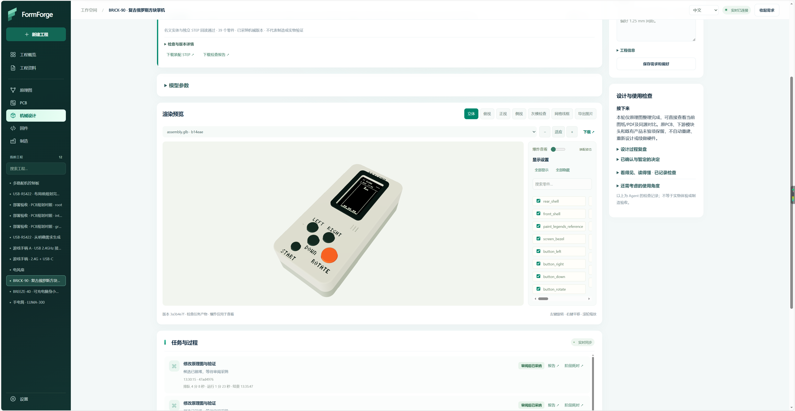
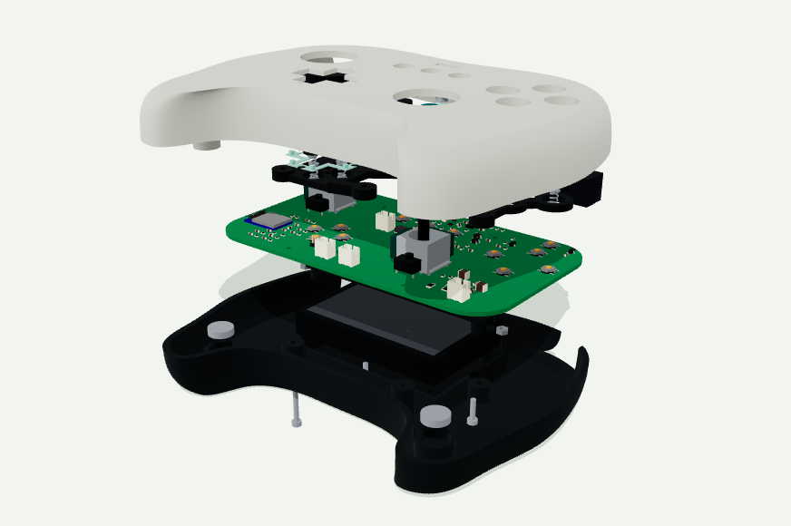
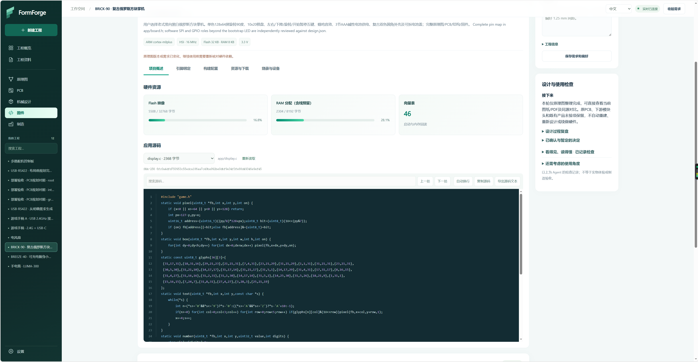

# FormForge

**说出你想要的东西，让 Agent 把它变成真实的产品。**

中文 · [English](README.en.md) · [GPL-3.0](LICENSE)

## 主案例：BRICK-90 复古掌机

**用 Agent 设计一台复古掌机：电路、PCB、外壳和游戏固件。**

我用 BRICK-90 展示 FormForge 的实际设计流程：从一台老式竖屏黑白俄罗斯方块掌机的需求出发，通过外部 Agent 调用工程工具，逐步完成电路、双层 PCB、结构装配和 STM32 游戏固件，并经过多轮修改与复核。

**[▶ 观看 / 下载完整设计流程视频（1 分 37 秒）](docs/videos/brick90-design-demo.mp4)**

1080p · 中文字幕 · 无旁白。视频回顾已有工程的需求、原理图、PCB、结构装配、固件和制造资料；上方动图截取其中的结构展开过程。

| BRICK-90 装配模型 | 内部结构与爆炸视图 |
| --- | --- |
|  |  |

*上图为 CAD 设计预览；屏幕画面用于外观参考。*

| 环节 | 这个案例中已经生成或检查的内容 |
| --- | --- |
| 电路与 PCB | KiCad 原理图、双层 PCB，以及对应版本的原生 ERC / DRC 检查 |
| 结构装配 | 外壳、按键、屏幕固定和电池仓设计，STEP / GLB 装配模型与独立打印件 STL |
| 游戏固件 | STM32 游戏应用、ARM GCC 构建产物 ELF / HEX / BIN，以及主机上的游戏逻辑测试 |
| 制造准备 | Gerber、钻孔、BOM、贴装坐标和结构件文件 |

这个案例包含人工决策和工程复核。目前已有设计文件与上述检查结果，实物装配、屏幕与按键运行、手感和续航仍待样机验证，制造交付也尚未完成。我希望先把每一步实际做到了什么展示清楚，再逐步走向完整的实物交付。

## 我为什么做 FormForge

我希望做一个电子产品，可以从这样一句话开始：

> “我需要一个游戏手柄。”

接下来，Agent 理解需求、提出方案，自动完成**原理图、PCB、机械结构和固件开发**，把这些设计结合起来检查，再为**电路板、贴片装配和结构件自动下单**，让设计进入真实制造与交付。

我想实现的体验是：**说出一个想要的东西，过一个星期，它就出现在家门口。**

这就是我做 FormForge 的目标：让“描述需求”到“收到实物”之间的距离越来越短。它是我希望逐步实现的完整体验；现阶段仍需要人在关键方案、工程复核和制造环节参与，实际交付周期取决于工艺和供应商。

为此，我把**需求、原理图、PCB、机械结构、固件和制造资料**放进同一个工程工作台。人可以在网页中查看和调整设计，外部 AI Agent 通过 MCP 调用工具，每一步留下实际工程文件、版本和检查结果。

我希望它既能帮助想把创意做成实物的人，也能成为开发硬件 Agent 时可以直接调用的工程工具。

## 可以用它做什么

| 工作 | FormForge 提供的能力 |
| --- | --- |
| 整理需求 | 保存产品要求、用户偏好、已确认决定、待解决问题和使用检查 |
| 设计电路 | 创建或导入 KiCad 原理图，编辑器件与连接，读取原生电气检查和连接关系 |
| 设计 PCB | 规划布局、编辑器件与铜线、自研布线与局部优化，检查板框、接口标注及规则 |
| 设计结构 | 参数化建模、完整 PCBA 装配、部件显隐和爆炸视图，导出 STEP / GLB / STL |
| 开发固件 | 绑定硬件版本与引脚，生成受支持的 STM32 模板、构建并读取 ELF / HEX / BIN |
| 准备制造 | 整理 Gerber、BOM、贴装坐标及结构件文件，解析外部制造资料，使用受控的供应商流程 |
| 管理工程 | 保留修订、候选、任务、失败记录、报告和资料来源，导入或导出工程包 |

我选择 **KiCad 10** 作为首个 EDA 后端，并保留 FormForge 自研的布局布线实现；机械建模使用 CadQuery / OpenCascade，固件构建使用 ARM GNU Toolchain。

## 更多项目与工作区

以下还展示了 USB 接收器、USB-RS422 接口板、游戏手柄和风扇等项目，以及 BRICK-90 在工作台中的结构视图。

### 原理图

原理图页面集中显示图纸、版本、器件、连接分组和检查结果。Agent 可以通过工具执行编辑，再用原生 ERC 与连接目标核对结果；网页用于查看和复核同一版本。

### PCB

从带有明确针序标注的 USB-RS422 接口板，到包含摇杆、按键和控制电路的游戏手柄 PCB，都可以在工作台中查看铜层与器件，并通过工具执行布局、布线和检查。接口可达性、安装孔、供电与返回路径等仍需要结合具体设计审查。

| USB-RS422 接口板 | 游戏手柄 PCB |
| --- | --- |
|  |  |

### 机械结构与装配

将电路板和元器件作为完整 PCBA，与外壳、电池、按键和紧固件一起考虑。通过参数、部件显隐、多视角和爆炸视图检查内部布局；导出的工程实体可以继续编辑和复核。

| 风扇结构与内部布局 | BRICK-90 掌机工作区 |
| --- | --- |
|  |  |

| 游戏手柄装配模型 | 游戏手柄爆炸视图 |
| --- | --- |
|  |  |

### 固件

固件与硬件依据和引脚绑定关联，页面可查看应用源码、Flash / RAM 使用量、向量表和构建产物。当前有 8 种 STM32 目标的 blink、UART echo 模板支持；其他模板以能力接口返回的范围为准。外部固件也可进入导入、格式检查和离线烧录计划流程。

## 怎样与 Agent 配合

**需求与使用场景 → 电路 → PCB → 结构装配 → 固件 → 制造资料与复核**

1. 在网页中创建工程，写明用途、接口、尺寸和约束。
2. 连接你选择的、能够访问本机 MCP 服务的外部 Agent。
3. 由 Agent 分析需求、提出方案并调用工具，专业引擎生成或检查实际工程文件。
4. 在网页查看候选、图纸、模型和报告，根据结果继续修改。
5. 检查通过且输入版本匹配后采纳相应结果；上游设计变化时，重新审查受影响的下游工作。

**Agent 负责推理和决策，FormForge 负责执行明确任务并保存工程证据。** 服务不内置绑定某家模型，也不自行调用收费模型。使用者仍需参与产品取舍、设计复核及必要的实物验证。

网页、HTTP 和 MCP 使用同一套业务入口，读取同一份工程与任务结果。

## 本地安装

目前主要验证 **Windows x64**。先准备 Python 3.12 和 Node.js；EDA 功能另需 KiCad 10。本轮安装测试使用 Python 3.12.14、Node.js 24.14 和 KiCad 10.0.6。

在仓库根目录运行 PowerShell：

~~~powershell
powershell -NoProfile -ExecutionPolicy Bypass -File scripts/Setup.ps1
powershell -NoProfile -ExecutionPolicy Bypass -File scripts/Start.ps1
~~~

默认访问 [本机工作台](http://127.0.0.1:17840)，也可双击“启动FormForge.cmd”。

按需要安装可选模块：

~~~powershell
# 机械建模
powershell -NoProfile -ExecutionPolicy Bypass -File scripts/Setup-Mechanical.ps1

# 外部制造文件解析
powershell -NoProfile -ExecutionPolicy Bypass -File scripts/Setup-Cam.ps1 -PythonExe .venv\Scripts\python.exe

# 离线烧录工具与芯片包
powershell -NoProfile -ExecutionPolicy Bypass -File scripts/Setup-Flash.ps1

# 采购浏览器及桌面界面
powershell -NoProfile -ExecutionPolicy Bypass -File scripts/Setup-ProcurementBrowser.ps1
powershell -NoProfile -ExecutionPolicy Bypass -File scripts/Setup-Desktop.ps1
~~~

固件构建还需安装 ARM GNU Toolchain，并在设置中选择工具链，或设置 FORMFORGE_ARM_GCC。KiCad 不在默认路径时，可设置 FORMFORGE_KICAD_CLI 和 FORMFORGE_KICAD_PYTHON。桌面版需要下载 Electron 运行时，网络受限时可使用安装脚本提供的 DownloadProxy 参数。

MCP 使用服务的 /mcp 入口及 Bearer 认证，令牌见本机 .local/api-token.txt；也可通过 scripts/stdio-proxy.py 接入。

## 当前验证范围

2026-11-04，我从仓库重新检出源码，在同一台 Windows 上新建 4 个独立 Python 环境进行了安装测试：

- **62 项 Python 与 41 项 Node 定向检查通过**，覆盖工程、原生工具、机械、制造文件、离线烧录与浏览器策略等选定流程。
- **8 种 STM32 × 2 种模板，共 16 次真实构建通过**，检查 ELF / HEX / BIN 与向量表。
- 实际网页完成工程创建、改名、8 个模块切换和窄屏设置检查；MCP 原生任务与 HTTP / 网页读取的修订一致。
- Electron 原生启动与工作台加载通过；隐藏窗口的供应商截图操作未计为通过。

这些结果建立在已配置的本机工具和测试样例上。PCB 草稿布线检查不等于完整实板验收，CAD 与构建通过也不等于实物性能或制造批准。干净 Windows / VM、真实供应商登录与实时交易、设备烧录及实物性能仍需分别验证。

可复现仓库内的基础检查：

~~~powershell
npm ci --no-audit --no-fund
npm run check
npm run build
.venv\Scripts\python.exe -m pytest tests/test_source_smoke.py
npm --prefix procurement-browser ci --ignore-scripts --no-audit --no-fund
node --test desktop/tests/*.test.cjs procurement-browser/tests/*.test.cjs
~~~

上述仓库自带基础检查是完整本机验收的一部分，不包含全部 103 项外部验收用例。

## 开源协议

我以 **GNU General Public License v3.0（GPL-3.0-only）** 发布 FormForge。你可以按协议使用、学习、修改和分发它；如果分发修改后的程序，也需要遵守 GPL-3.0 的源码提供和许可要求。

完整条款见 [LICENSE](LICENSE)。项目中保留独立许可的第三方代码、字体和资源，见 [第三方许可说明](THIRD_PARTY_NOTICES.md)。

欢迎通过 Issues 和 Pull Requests 交流使用体验、报告问题或一起完善这个项目。
